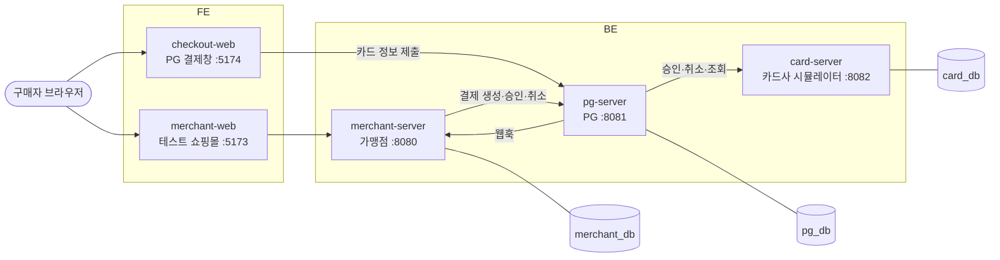
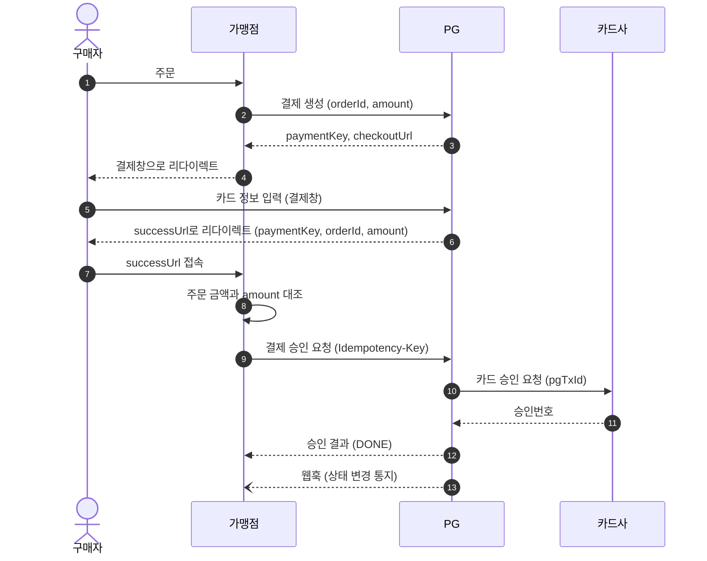
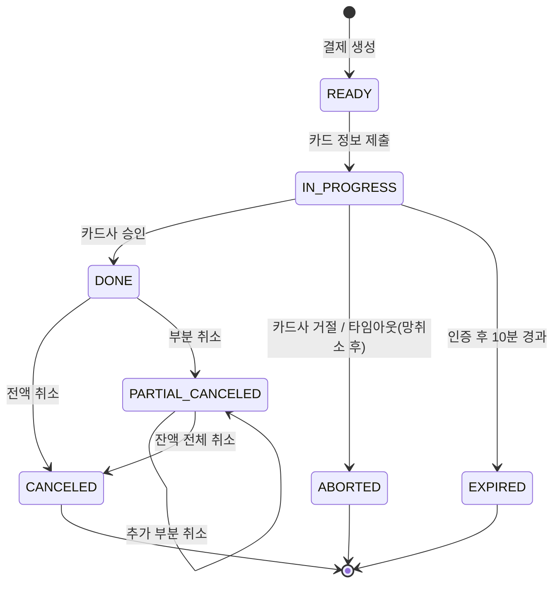

# paypipe

가맹점·PG·카드사 3개 서버를 직접 구현해 카드 결제의 **승인·취소·정산** 전 과정을 재현하는 자체 PG 결제 시스템입니다.
핵심 목표는 기능 개수가 아니라 **어떤 장애 상황에서도 돈이 틀리지 않는 것**입니다.

## 목차

- [목표와 범위](#목표와-범위)
- [아키텍처](#아키텍처)
- [결제 흐름](#결제-흐름)
- [결제 상태](#결제-상태)
- [핵심 설계 원칙](#핵심-설계-원칙)
- [개발 단계](#개발-단계)
- [기술 스택](#기술-스택)
- [프로젝트 구조](#프로젝트-구조)
- [실행 방법](#실행-방법)
- [브랜치 전략](#브랜치-전략)
- [커밋 컨벤션](#커밋-컨벤션)

## 목표와 범위

### 목표

- 결제 1건은 정확히 1번만 승인되고, 금액과 상태가 3개 서버에서 일치한다
- 카드사 지연·무응답, 가맹점 중복 요청 상황에서도 데이터 정합성을 유지한다
- 실제 PG 연동 구조(인증 → 승인 2단계, 웹훅, 정산·대사)를 그대로 따라 실무 흐름을 익힌다

### 결제 방식

| 구분 | 내용 |
| --- | --- |
| 결제수단 | 신용카드 일시불 |
| 결제 방식 | 인증결제 (구매자 인증 → 가맹점 승인 요청의 2단계) |
| 거래 형태 | 일반결제 (비에스크로). 승인 즉시 확정 |
| 정산 | PG 대행 정산. 매일 전일 거래를 가맹점별로 집계해 수수료를 뺀 금액 산출 |

### 범위

| 구분 | 내용 |
| --- | --- |
| 포함 | 카드 일시불 결제, 전체·부분 취소, 웹훅 통지, 일 단위 정산·대사, 가맹점 API 키 인증, 카드번호 암호화·마스킹 |
| 제외 | 실제 카드사·VAN 연동, 할부·간편결제·계좌이체, 3D Secure 본인인증, PCI-DSS 수준의 보안, 결제창 UI 고도화 |

## 아키텍처

독립 실행되는 서버 3개가 HTTP API로만 통신하고, 각자 자기 DB만 사용합니다. 가맹점은 카드사와 직접 통신하지 않으며 모든 결제는 PG를 거칩니다.



구매자는 가맹점에서 주문하고, 카드 정보는 가맹점이 아닌 **PG 결제창**에 입력합니다. 그래서 가맹점 서버는 카드번호를 한 번도 보지 않습니다.

| 서버 | 역할 | 포트 | 저장소 |
| --- | --- | --- | --- |
| merchant-server | PG를 사용하는 테스트 쇼핑몰 | 8080 | merchant_db |
| pg-server | 결제 생성·승인·취소·정산·대사. 결제 상태의 유일한 기준(Source of Truth) | 8081 | pg_db |
| card-server | 승인 판단, 장애 재현(지연·무응답·응답 유실) | 8082 | card_db |

## 결제 흐름

결제는 **생성 → 인증 → 승인 → 통지** 4구간으로 진행됩니다. 카드사에서 실제 금액이 승인되는 것은 가맹점이 금액을 대조한 뒤 보내는 승인 요청(9단계)뿐입니다.



- **인증과 승인을 나누는 이유**: 구매자 브라우저를 거치는 6·7단계에서는 금액이 조작될 수 있습니다. 가맹점이 자기 DB의 주문 금액과 대조하고(8단계), PG가 다시 검증해(9단계) 이중으로 막습니다.
- **승인 결과의 기준**: 가맹점은 12단계 응답으로 주문을 처리합니다. 13단계 웹훅은 네트워크 문제로 12단계 응답을 받지 못한 경우를 보완하는 수단입니다.

## 결제 상태

허용된 전이 외의 상태 변경은 엔티티 메서드에서 예외로 막습니다. 최종 상태(CANCELED, ABORTED, EXPIRED)에서는 어떤 요청도 받지 않습니다.



## 핵심 설계 원칙

| 영역 | 원칙 |
| --- | --- |
| 정합성 | 금액은 정수(long, 원 단위)로만 계산. `balance_amount = amount − 취소 합계`를 취소와 같은 트랜잭션에서 갱신 |
| 멱등성 | 승인·취소 API는 `Idempotency-Key` 필수. 같은 키는 첫 응답 재사용, 본문이 다르면 422, 처리 중이면 409. PG → 카드사는 pgTxId로 중복 승인 방지 |
| 동시성 | 승인·취소 시 결제 행을 `SELECT ... FOR UPDATE`로 잠근 뒤 검증. 카드사 호출 중에는 DB 락을 잡지 않음. 카드 한도는 조건부 UPDATE로 차감 |
| 장애 대응 | 카드사 타임아웃은 "실패"가 아니라 "결과 모름". 망취소로 승인 기록을 없앤 뒤에만 ABORTED로 확정하고, 상태 복구 배치와 대사 배치로 한 번 더 확인 |
| 보안 | 카드번호 AES-256-GCM 암호화, 화면·로그·응답에는 마스킹 값만 사용. 시크릿 키 BCrypt 해시 저장. 웹훅 HMAC-SHA256 서명 |
| 관측성 | 모든 요청에 `X-Request-Id`를 발급·전파해 3개 서버 로그를 하나의 흐름으로 추적 |

## 개발 단계

단계마다 지정된 테스트 시나리오를 자동화 테스트로 통과해야 다음 단계로 넘어갑니다. 일정이 밀리면 3·4단계 범위를 줄이되, **2단계는 줄이지 않습니다.**

| 단계 | 목표 | 주요 기능 | 검증 시나리오 |
| --- | --- | --- | --- |
| 1단계 | 기본 결제 흐름 | 가맹점 등록·인증, 결제 생성·인증·승인·조회, 카드 승인 | 정상 결제, 한도 초과, 금액 위변조 |
| 2단계 | 정합성 | 멱등성, 망취소, 상태 복구 배치, 카드사 장애 주입 | 동시 승인 100건, 카드사 타임아웃, 응답 유실, 인증 후 이탈 |
| 3단계 | 취소·통지·정산 | 전체·부분 취소, 웹훅 발송·수신, 정산·대사 배치 | 동시 부분 취소, 웹훅 재시도, 정산 재시작 |
| 4단계 | 마무리 | 감사 로그, 로그 보안 검증, 문서화 | 로그 내 카드번호·시크릿 키 0건 |

## 기술 스택

| 영역 | 선택 |
| --- | --- |
| BE | Java 21, Spring Boot 3.5, Spring Data JPA, Gradle (멀티모듈) |
| DB | MySQL 8.4 (서버별 스키마·계정 분리) |
| 배치 | Spring Batch (3단계부터) |
| 테스트 | JUnit 5, Testcontainers (실제 MySQL로 동시성 테스트) |
| FE | React, TypeScript, Vite |
| 실행 환경 | Docker Compose |

## 프로젝트 구조

```
FE/
  merchant-web/        테스트 쇼핑몰 화면            :5173
  checkout-web/        PG 결제창 (카드 정보 입력)    :5174
BE/                    Gradle 멀티모듈
  merchant-server/     가맹점 서버                   :8080  merchant_db
  pg-server/           PG 서버                       :8081  pg_db
  card-server/         카드사 시뮬레이터             :8082  card_db
  libs/observability/  Request-Id 전파, JSON 로그, 마스킹
  e2e-test/            3개 서버 통합 시나리오 테스트
INFRA/
  docker-compose.yml   MySQL 8.4 + 서버 3개
  mysql/init/          서버별 스키마·계정 생성
  docker/              BE 공용 Dockerfile
Docs/                  다이어그램, API 명세, 트러블슈팅
```

- 각 서버 내부는 기능(도메인)별로 패키지를 나눕니다. 예: `com.paypipe.pg.payment`, `com.paypipe.pg.webhook`
- 서버 간 DTO 공유 모듈은 두지 않습니다. 서버 간 계약은 HTTP API 명세로만 맺습니다.

## 실행 방법

```bash
# 전체 실행 (MySQL + 서버 3개)
cd INFRA && docker compose up -d --build

# BE 빌드·테스트 (Docker 필요: Testcontainers MySQL 사용)
cd BE && ./gradlew build

# 서버 하나만 로컬 실행 (MySQL은 compose로 띄워 둔 상태)
cd INFRA && docker compose up -d mysql
cd BE && ./gradlew :pg-server:bootRun

# FE
cd FE/merchant-web && npm install && npm run dev
```

JDK 21이 없어도 Gradle toolchain이 자동으로 내려받습니다.

## 브랜치 전략

```
main ← dev ← {도메인}/{작업 유형}/{기능 단위}
```

| 브랜치 | 용도 | 생성 위치 | 병합 대상 |
| --- | --- | --- | --- |
| `main` | 단계(마일스톤)가 완료된 안정 버전 | — | — |
| `dev` | 개발 통합 브랜치 | `main` | `main` |
| `{도메인}/{작업 유형}/{기능 단위}` | 실제 작업 브랜치 | `dev` | `dev` |

### 작업 브랜치 이름 규칙

**도메인**

| 도메인 | 대상 |
| --- | --- |
| `BE` | `BE/` 백엔드 |
| `FE` | `FE/` 프론트엔드 |
| `INFRA` | `INFRA/` Docker, DB 초기화, 배포 설정 |
| `DOCS` | `Docs/`, README |

**작업 유형**

| 유형 | 용도 |
| --- | --- |
| `feature` | 새 기능 |
| `fix` | 버그 수정 |
| `refactor` | 동작 변경 없는 구조 개선 |
| `test` | 테스트 추가·수정 |
| `chore` | 빌드 설정, 의존성 등 기타 작업 |
| `hotfix` | `main`에서 바로 고쳐야 하는 긴급 수정 (`main`에서 생성해 `main`과 `dev`에 모두 병합) |

**기능 단위**: 소문자 kebab-case로 작성하고, 이슈가 있으면 번호를 앞에 붙입니다.

```
BE/feature/payment-confirm
BE/feature/12-idempotency-key
BE/fix/cancel-balance-race
FE/feature/checkout-card-form
INFRA/chore/mysql-init-script
DOCS/feature/api-spec
```

### 작업 흐름

1. `dev`에서 작업 브랜치를 만든다
2. 작업 후 `dev`로 Pull Request를 올리고, 리뷰 승인 후 병합한다
3. 단계(마일스톤)가 끝나면 `dev` → `main`으로 Pull Request를 올려 병합한다
4. 병합된 작업 브랜치는 삭제한다

## 커밋 컨벤션

[Conventional Commits](https://www.conventionalcommits.org/ko/v1.0.0/) 형식을 따릅니다.

```
<type>(<scope>): <subject>

<body>

<footer>
```

### type

| type | 용도 |
| --- | --- |
| `feat` | 새 기능 |
| `fix` | 버그 수정 |
| `refactor` | 동작 변경 없는 코드 구조 개선 |
| `test` | 테스트 추가·수정 |
| `docs` | 문서 수정 |
| `style` | 포맷팅, 세미콜론 등 동작에 영향 없는 변경 |
| `perf` | 성능 개선 |
| `build` | 빌드 설정, 의존성 변경 |
| `ci` | CI 설정 변경 |
| `chore` | 기타 작업 |

### scope

변경 대상을 적습니다. 여러 곳에 걸치면 생략합니다.

| scope | 대상 |
| --- | --- |
| `merchant` | merchant-server |
| `pg` | pg-server |
| `card` | card-server |
| `observability` | libs/observability |
| `e2e` | e2e-test |
| `merchant-web` | FE/merchant-web |
| `checkout-web` | FE/checkout-web |
| `infra` | INFRA |

### 작성 규칙

- **subject**: 무엇을 했는지 50자 이내로 쓰고, 끝에 마침표를 찍지 않습니다. 한글로 작성해도 됩니다.
- **body**: 선택 사항입니다. 무엇을 왜 바꿨는지 씁니다.
- **footer**: 선택 사항입니다. 관련 이슈(`Closes #12`)나 하위 호환이 깨지는 변경(`BREAKING CHANGE: ...`)을 적습니다.
- 커밋 하나에는 변경 하나만 담습니다.

### 예시

```
feat(pg): 결제 승인 API 구현

결제 생성 금액과 승인 요청 금액을 대조하고, 인증 후 10분이 지나면 AUTH_EXPIRED로 거절한다.

Closes #12
```

```
fix(card): 동시 승인 시 한도 초과 차감 문제 수정
test(pg): 동일 Idempotency-Key 동시 요청 100건 테스트 추가
build: Spring Boot 3.5.16으로 업그레이드
docs: README에 결제 흐름 다이어그램 추가
```
